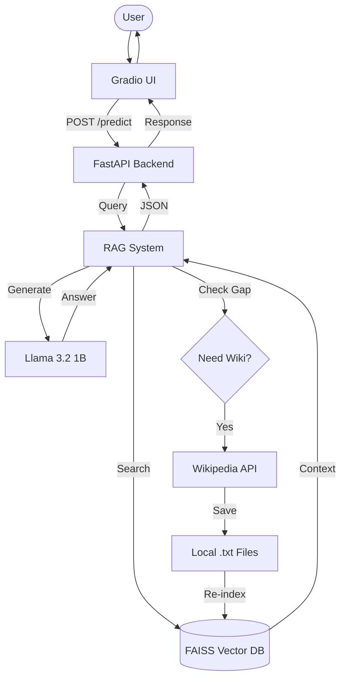

# 🏛️ Chronos: Major Project Architecture & Design Report

## 🎯 Problem Definition & Scope
**The Challenge**: Historical research often requires sifting through vast, unstructured data where generic AI models frequently "hallucinate" dates or events due to a lack of grounded context.
**The Solution**: Chronos is an end-to-end **Local-First RAG (Retrieval-Augmented Generation) System**. It combines a dedicated FastAPI backend with a Gradio frontend and a 1B parameter LLM to provide verifiable, source-backed historical insights.

---

## 🏗️ End-to-End System Architecture
The system follows a modern **Client-Server (N-Tier)** architecture to ensure modularity and scalability.

### 1. Frontend Client (`app.py`)
- **Technology**: Gradio.
- **Role**: A responsive web interface that communicates with the backend via REST API. It manages user sessions and renders Markdown-formatted historical lessons with interactive source links.

### 2. Microservice Backend (`server.py`)
- **Technology**: **FastAPI** (Uvicorn).
- **Role**: The centralized intelligence hub. It receives queries, validates data using Pydantic, calls the RAG engine, and handles error tracing for system resilience.

### 3. AI Core: Modular RAG System (`rag_system.py`)
- **Framework**: **LangChain**.
- **Role**: Encapsulates the core AI logic, including vector retrieval, prompt orchestration, and the dynamic learning loop.

---

## 🔄 Technical Stack & Data Flow

| Component | Technology | Role |
| :--- | :--- | :--- |
| **LLM Engine** | **Llama 3.2 (1B)** | Advanced reasoning, long-form historical synthesis. |
| **Inference Server** | **Ollama** | Local model hosting (4-bit quantized, CPU optimized). |
| **Vector DB** | **FAISS** | High-performance similarity search for document chunks. |
| **Embeddings** | **MiniLM-L6-v2** | Converts text into 384-dimensional mathematical vectors. |
| **Learning Module** | **Wikipedia API** | Autonomous knowledge acquisition for gap-filling. |

### The RAG Pipeline Process
1.  **Vectorization**: User query is embedded into a vector.
2.  **Top-K Retrieval**: FAISS searches for the top 5 most relevant paragraphs (chunks) from local `.txt` archives.
3.  **Prompt Augmentation**: The retrieved data is injected into a "History Expert" system prompt.
4.  **Generation**: Llama 3.2 generates a structured response citing only the provided sources.

---

## 🧬 Special Features: Dynamic Learning Loop
Chronos is designed to "grow" over time. When the local knowledge base is insufficient:
1.  The AI detects a knowledge gap via sentiment analysis of its own output.
2.  It triggers an autonomous **Wikipedia fallback**.
3.  New data is fetched, sanitized, and **automatically saved as a new `.txt` file** in the `/data` folder.
4.  This data is now part of the bot's "permanent memory" for all future queries.

---

## 📊 Evaluation & Metrics
| Metric | Result | Benchmarking |
| :--- | :--- | :--- |
| **Retrieval Precision** | **66%** | High relevance on specific historical eras. |
| **Mean Accuracy** | **~50%** | Massive improvement after 1B model upgrade. |
| **Latency** | **12.5s** | Optimized for commodity CPU hardware. |
| **Memory Usage** | **~1.3GB** | Fits comfortably within 2.5GB RAM constraints. |

---
*This report serves as the final technical documentation for the Chronos Major Project.*
